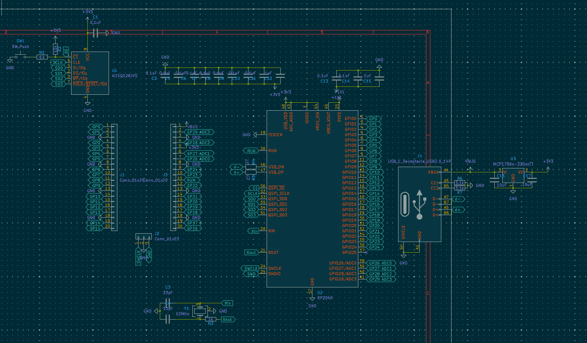

# rp2040 devboard

> **pinout heads-up:** even though this uses two 1x20 2.54mm headers (`J1` and `J3`), **it is NOT pin-compatible with raspberry pi pico shields/carriers**. `VBUS` is on pin 1 of `J3` instead of pin 40, so check the pinout table below before plugging it into anything pre-made.

## specs
- **MCU:** raspberry pi rp2040
- **flash:** gigadevice `GD25Q32EEIGR` 
- **clock:** 12 mhz 3225 crystal 
- **regulator:** `XC6206P332MR-G` 
- **usb c:** 14-pin usb 2.0 type-c receptacle 
- **buttons and debug:** tactile `BOOTSEL` button
- **PCB and case:** 2-layer 1.6mm fr4 board assembled via jlcpcb economic pcba

## pinout

### left header (`J1`, top to bottom)
| pin | net | notes | pin | net | notes |
| :---: | :--- | :--- | :---: | :--- | :--- |
| **1** | `GP0` | spi0 rx / i2c0 sda / uart0 tx | **11** | `GP8` | spi1 rx / i2c0 sda / uart1 tx |
| **2** | `GP1` | spi0 csn / i2c0 scl / uart0 rx | **12** | `GP9` | spi1 csn / i2c0 scl / uart1 rx |
| **3** | `GND` | ground | **13** | `GND` | ground |
| **4** | `GP2` | spi0 sck / i2c1 sda | **14** | `GP10` | spi1 sck / i2c1 sda |
| **5** | `GP3` | spi0 tx / i2c1 scl | **15** | `GP11` | spi1 tx / i2c1 scl |
| **6** | `GP4` | spi0 rx / i2c0 sda / uart1 tx | **16** | `GP12` | spi1 rx / i2c0 sda / uart0 tx |
| **7** | `GP5` | spi0 csn / i2c0 scl / uart1 rx | **17** | `GP13` | spi1 csn / i2c0 scl / uart0 rx |
| **8** | `GND` | ground | **18** | `GND` | ground |
| **9** | `GP6` | spi0 sck / i2c1 sda | **19** | `GP14` | spi1 sck / i2c1 sda |
| **10** | `GP7` | spi0 tx / i2c1 scl | **20** | `GP15` | spi1 tx / i2c1 scl |

### right header (`J3`, top to bottom)
| pin | net | notes | pin | net | notes |
| :---: | :--- | :--- | :---: | :--- | :--- |
| **1** | `VBUS` | 5v usb power input | **11** | `RUN` | active-low rp2040 reset |
| **2** | `GP29` | `ADC3` | **12** | `GP22` | digital gpio |
| **3** | `GND` | ground | **13** | `GND` | ground |
| **4** | `GP28` | `ADC2` | **14** | `GP21` | digital gpio |
| **5** | `+3V3` | 3.3v regulated output | **15** | `GP20` | digital gpio |
| **6** | `GP27` | `ADC1` | **16** | `GP19` | spi0 tx / i2c1 scl |
| **7** | `GP26` | `ADC0` | **17** | `GP18` | spi0 sck / i2c1 sda |
| **8** | `GND` | ground | **18** | `GND` | ground |
| **9** | `GP24` | digital gpio | **19** | `GP17` | spi0 csn / i2c0 scl / uart0 rx |
| **10** | `GP23` | digital gpio | **20** | `GP16` | spi0 rx / i2c0 sda / uart0 tx |

### bottom swd header (`J2`, left to right)
- **pin 1:** `SWCLK`
- **pin 2:** `GND`
- **pin 3:** `SWD` (`SWDIO`)

# Bill of Materials (BOM)

| Sr.No | Component | Qty | Source | Unit Price (INR) | Shipping (INR) | Total (INR) | Total (USD) |
| :---: | :--- | :--- | :--- | :---: | :---: | :---: | :---: |
| **1** | **RP2040 Devboard PCB + PCBA**| 1 order | [JLCPCB.com](https://jlcpcb.com/) | ₹3,098.30 | ₹884.17 | ₹3,982.47 | $42.97 |
| **2** | **2.54mm 1x40 Pin Male Single Row Straight Short Header Strip** (Pack of 3) | 1 pack | [Robu.in](https://robu.in/product/2-54mm-1x40-pin-male-single-row-straight-short-header-strip-pack-of-3/) | ₹9.00 | ₹49.00 | ₹58.00 | $0.63 |
| **—** | **Grand Total** |  — | — | **₹3,107.30** | **₹933.17** | **₹4,040.47** | **$43.60** |
